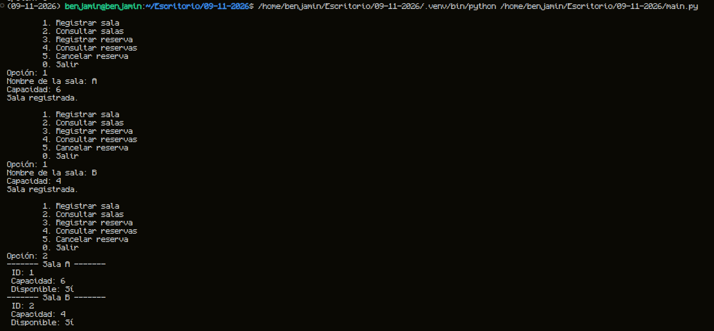
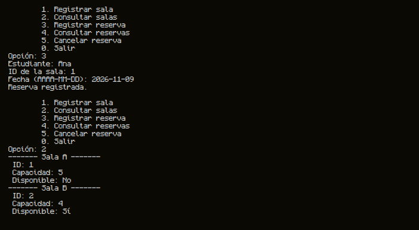
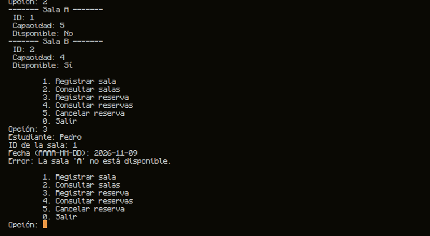
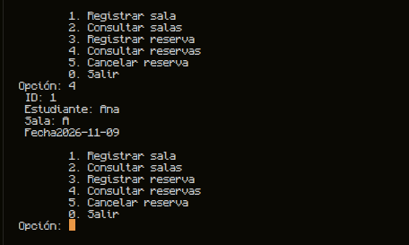
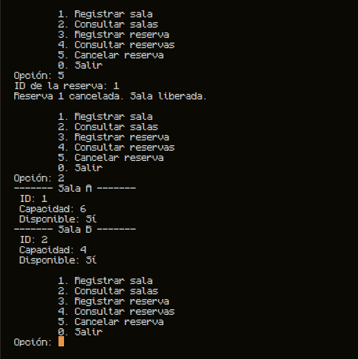
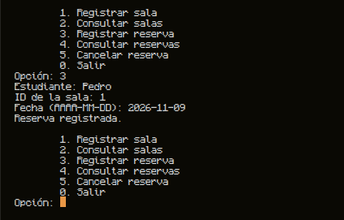

# Instalacion uv

En este taller se hizo uso de uv como gestor de paquetes de python.

macOS y Linux en Terminal
```bash
curl -LsSf https://astral.sh/uv/install.sh | sh
```
Windows con PowerShell
```bash
powershell -ExecutionPolicy ByPass -c "irm https://astral.sh/uv/install.ps1 | iex"
```

# Sincronizacion de Paquetes con uv
Para poder ejecutar el proyecto tanto en macOS, Linux o Windows se debe ejecutar el siguiente comando en terminal:

```bash
uv sync
```

Luego de esto se puede ejecutar el programa desde main.py

# Pruebas

## 1. CP-01 | Crear Sala A (6 cupos) y Sala B (4 cupos). Ambas Disponibles



-------


## 2. CP-02 | Reservar Sala A para Ana. Reserva registrada; Sala A no disponible



--------


## 3. CP-03 | Reservar Sala A para Pedro. Operación rechazada




--------

## 4. CP-04 | Consultar reservas. Se muestra la reserva de Ana



--------

## 5. CP-05 | Cancelar reserva de Ana. Sala A vuelve a disponible



--------

## 6. CP-06 | Reservar Sala A para Pedro. Reserva aceptada


 